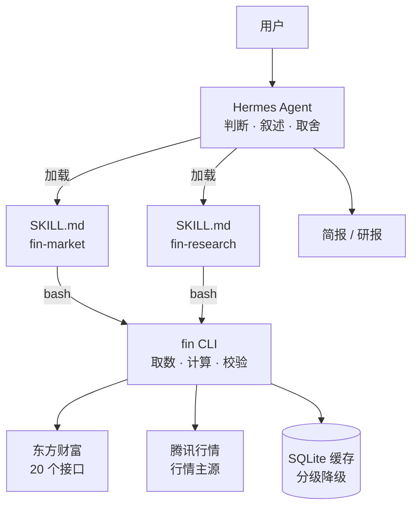

# 金融研究智能体

**给 A 股研究用的 Agent：每天自动出一份盘后简报，随时问一家公司的底细。**

数字全部来自公开数据源，每个结论都能追溯到出处。不预测涨跌，不荐股。

[](https://www.python.org/)
[](LICENSE)
[](#数据来源)
[](docs/hermes-integration.md)

---

## 它能做什么

<table>
<tr>
<td width="50%">

### 每日盘后简报

每个交易日 15:35 自动生成：

- 指数表现与成交额
- 涨跌家数、涨停跌停
- 板块冷热与资金流向
- 重点资讯（带来源）
- 次日披露与解禁提醒
- **昨日判断回顾**：昨天的预判今天验证了没有

</td>
<td width="50%">

### 个股研究

对话里说一句就行：

> 帮我看看宁德时代

两分钟内拿到：

- 行情、估值、市值
- 最近 4 期财务，含同比与 ROE
- 最可比的同业公司对比
- 近期公告与新闻，逐条可点开
- 规则引擎扫描出的风险项

</td>
</tr>
</table>

---

## 一次真实输出

> 2026-10-22 收盘后实测，非构造数据。

```
今日 A 股普跌，成长板块跌幅更大。
上证指数 3658.03（-1.48%），深证成指 -2.96%，创业板指 -4.37%，
科创50 -2.78%。全市场 450 只上涨，4811 只下跌，两市成交 20077 亿元，
涨停 33 家 [market.breadth][market.indexes]。

板块方面，只有少数方向收红：医美耗材 +2.35%、医疗美容 +1.71%、
玻璃制造 +0.83%。跌幅最大的是印制电路板 -6.01%，其主力资金净流出
62.03 亿元 [sector.top/bottom]。

数据说明：行业板块原始 496 个（含二三级），按一级去重后 205 个；
快讯接口只返回标题，没有原文链接 [warnings]。

以上内容均为公开信息整理，不构成买卖建议。
```

```bash
$ fin risk 300750
```

```
宁德时代(300750) 命中 4 条风险
[高] 股价异动    2026-10-21 单日下跌 -12.03%          (push2his/kline)
[中] 成交量异动  2026-10-21 量比 3.25                 (push2his/kline)
[中] 区间回撤    近 20 日区间回撤 -27.6%              (push2his/kline)
```

---

## 架构



**核心边界：数字归 CLI，判断归 Skill。**

LLM 不取数、不做算术、不凭记忆补全，它只能引用 CLI 本次输出的字段。
金融场景里，模型编一个数字的代价远高于它写出漂亮的分析。

---

## 快速开始

```bash
git clone <本仓库>
cd fin-research-assistant
pip install -e .
```

```bash
fin market quote                 # 大盘指数
fin market sector --limit 5      # 板块涨跌
fin resolve 宁德时代             # 名称 → 代码
fin stock 300750 --parts quote,financials,peers
fin risk 300750                  # 风险规则扫描
fin brief assemble               # 日报数据骨架
```

所有命令输出统一 JSON：

```json
{
  "ok": true,
  "cmd": "stock.quote",
  "as_of": "2026-10-22T17:05:56+08:00",
  "data": { "300750": { "price": 220.41, "pe_ttm": 11.63, "pb": 2.64 } },
  "sources": [{ "name": "腾讯", "endpoint": "qt.gtimg.cn" }],
  "warnings": ["PE 存在多个口径：动态 11.85 / TTM 11.63，报告统一使用 PE-TTM"],
  "cache": "hit"
}
```

`warnings` 是刻意设计的出口：字段缺失、口径冲突、降级原因都必须显式暴露给模型，
而不是让它自由发挥。

### 接入 Hermes

```bash
# 生成可安装的 profile 分发包
python scripts/build_distribution.py --force

hermes profile install ./dist/finance-dist --name finance --alias
python -m pip install -e ~/.hermes/profiles/finance
hermes -p finance gateway install    # 定时任务需要 gateway 常驻
```

细节见 [部署文档](docs/hermes-integration.md)。

---

## 命令

| 命令 | 说明 |
|---|---|
| `fin resolve <名称/代码>` | 解析股票，歧义时返回候选列表 |
| `fin market quote` | 主要指数行情 |
| `fin market breadth` | 涨跌家数（沪指 + 深成指口径） |
| `fin market sector` | 行业板块涨跌与资金流（已去重二三级） |
| `fin market limitup` | 涨停家数 |
| `fin stock <标的> --parts ...` | `quote` / `financials` / `peers` / `risk` / `news` / `announce` / `reports` / `calendar` / `all` |
| `fin risk <标的>` | 10 条确定性风险规则 |
| `fin news list` | 7×24 财经快讯 |
| `fin calendar [标的]` | 解禁与业绩披露日程 |
| `fin brief assemble` | 日报骨架（含前一日简报） |

全局参数 `--offline`：只用本地缓存，断网也能演示。

---

## 数据来源

**不需要任何 API Key。** 全部是公开接口，直接调用，不经过第三方封装。

| 用途 | 主源 | 备源 |
|---|---|---|
| 行情、PE/PB/市值 | 腾讯 `qt.gtimg.cn` | 东财 `push2/stock/get` |
| 涨跌家数 | 东财 `push2/ulist.np` | 不可用时明确标注缺失 |
| 行业板块 | 东财 `push2/clist` | 数据中心 `RPT_INDUSTRY_FUNDFLOW` |
| 行业归属 / 成分股 | 数据中心 `RPT_F10_CORETHEME_BOARDTYPE` | — |
| 财务指标 | `datacenter.eastmoney.com` | — |
| 资讯 / 公告 / 研报 | `np-listapi` / `np-anotice` / `reportapi` | — |
| 涨停跌停 | `push2ex.eastmoney.com` | — |

### 为什么不直接用现成的股票库

AKShare、Tushare 都是对这些接口的封装。直接调的好处是：

- **字段可溯源**：报错会直接返回「列不存在」这类可行动信息，而不是被上层吞掉
- **零额外依赖**：只需要 `requests`
- **可控降级**：哪个接口挂了、挂了多少、用了多久前的缓存，都能精确表达

代价是要自己维护适配层——所以有了下面这些坑。

---

## 踩过的坑

真实排查记录，完整版见 [技术文档](docs/技术文档.md#6-工程问题与解决)。

### 接口声明 UTF-8，实际返回 GBK

财务接口返回 200，`json.loads` 成功，但数据是空数组。
打印原始字节才发现中文全是乱码——**而 `decode('utf-8')` 不报错**，
因为 GBK 的双字节恰好构成了合法的 UTF-8 字符，只是语义错误。

修复方式是乱码特征评分：拉丁扩展/希腊/西里尔字符加分，正常 CJK 减分，
两种编码各解一次取低分。实测 UTF-8 得 -44、GB18030 得 -50，判为 GBK 正确。

### 参数双重编码

```
正常：filter=%28SECUCODE%3D%22300750.SZ%22%29
异常：filter=%2528SECUCODE%253D%2522300750.SZ%2522%2529
```

代码里先 `quote()` 预编码，`requests` 又编码一次，`%` 变成 `%25`。
上游不认识这个过滤器，返回空结果而不是报错。

### 数据源被封后换路

开发当天东财 `push2` 被 WAF 封了（TLS 握手被服务端主动断开）。
同业对比原本依赖 `clist`，改走数据中心的 `RPT_BOARD_CONSTITUENT` 后
不仅恢复，还多拿到 PE 历史分位和股息率。

---

## 评测

### 数字保真度

`evals/check_fidelity.py` 把 CLI 输出的 JSON 展平成数值集合，
抽取报告中的所有数字逐项比对。

| 报告 | 保真度 | 可疑数字 |
|---|---|---|
| 全部数字来自 CLI | 100%（11/11） | — |
| 混入一个编造数字 | 92%（11/12） | `[37.5]` |

### 黄金问题集

`evals/golden.jsonl` 共 10 条，覆盖行情解读、个股研究、同业对比、
歧义消解、休市处理、风险扫描。每条声明期望命令与检查点。

---

## 项目结构

```
src/fin/                     2,448 行
├── cli.py            306    命令入口，只做参数解析与输出
├── http.py           182    限速、重试、编码识别、缓存降级
├── store.py          159    SQLite 缓存与符号表
├── symbols.py        132    代码换算、名称解析
├── sources/                 上游接口薄封装，不做语义加工
│   ├── eastmoney.py  447    20 个接口
│   └── tencent.py     85    行情主路径
└── api/                     业务语义层：字段映射、warnings、规则
    ├── market.py     361    指数、涨跌家数、情绪、板块
    ├── stock.py      243    行情估值、财务、行业识别、同业
    ├── news.py       152    快讯、公告、研报、日程
    ├── risk.py       163    风险规则引擎
    └── brief.py      106    日报骨架

skills/                     270 行
├── fin-market/SKILL.md     每日简报：步骤、模板、硬规则
└── fin-research/SKILL.md   个股研究：步骤、模板、硬规则

evals/                      保真度检查、黄金问题集、快照
scripts/                    分发包构建、多副本同步
docs/                       技术文档、部署文档、实现记录
```

分层严格单向：`cli → api → sources → http`。
数据源替换只改 `sources`，不影响上层。

---

## 风险规则

规则是确定性的，LLM 只能解释和排序，不能增删命中项。

| 规则 | 触发条件 |
|---|---|
| 股价异动 | 近 20 日单日跌幅 ≤ -7% |
| 成交量异动 | 量比 ≥ 2.5 |
| 区间回撤 | 近 20 日回撤 ≤ -15% |
| 高负债率 | 资产负债率 > 70% |
| 毛利率下滑 | 较上一报告期下降 ≥ 5 个百分点 |
| 亏损 | 归母净利润 < 0 |
| 估值异常 | PE-TTM < 0 |
| 估值溢价 | PE 高于行业中位数 150% 以上 |
| 重大公告 | 标题命中立案/退市/预亏/减持等关键词 |
| 解禁压力 | 未来 90 天内有解禁 |

---

## 已知限制

- 涨跌家数依赖单一接口，不可用时返回 `unavailable` 并用涨跌停统计替代
- 全市场涨跌分布未实现：需逐只行情，实测约 224 秒，性价比低
- 北向资金未实现：2024-08 起停止实时披露
- 黄金问题集已就绪但未跑批（单次运行需调用模型）
- 定时任务需要 Hermes gateway 常驻

---

## 合规

- 内容为公开信息整理，供研究参考，**不构成投资建议**
- 不预测股价涨跌，不提供买入/卖出/持有建议
- 资讯与公告只展示标题、摘要和原文链接，不转载全文
- 接口调用串行限速，不做高频轮询

---

## License

[MIT](LICENSE)
